<!-- Originaltext wörtlich übernommen (inkl. Tippfehler). Screenshot: _raw/screenshots/in-building.png -->

...
In Business und Industrie ist eine Menge an Information und Design im Büro, Konferenz- oder Besprechungsraum, im Eingangsbereich oder auch schon bei der Zufahrt zum Objekt gefragt. Die Mitarbeiter möchten sich wohl fühlen, Ihre Besucher und Kunden möchten Sie leicht finden. Auch die Aussenanlagen übermitteln schon Ihre Botschaft.
Damit dienen wir: Von der Folierung der Scheiben als Sonnen oder Sichtschutz, Trennwände, Aufsteller, Pylone, Wandgestaltungen, Leit- und Infosysteme, Flucht- und Rettungspläne, Fahnenmasten, Lichtkästen, LED Anlagen bis hin zum Parkplatzschild.

## Bilder (Reihenfolge alphabetisch, nicht wie im Original-Layout)

- 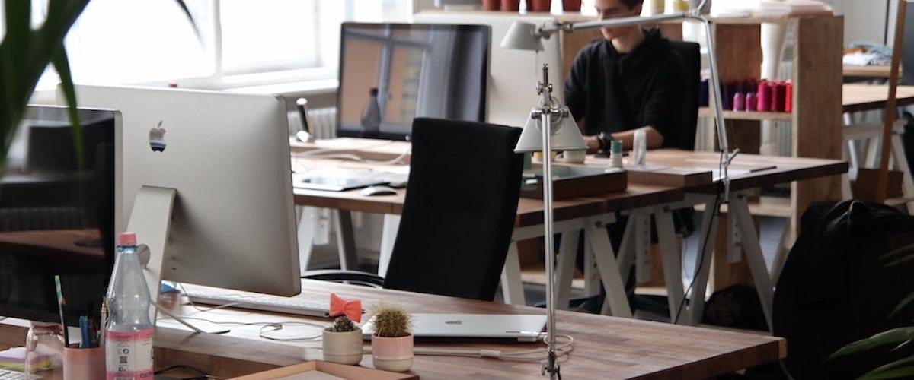
- 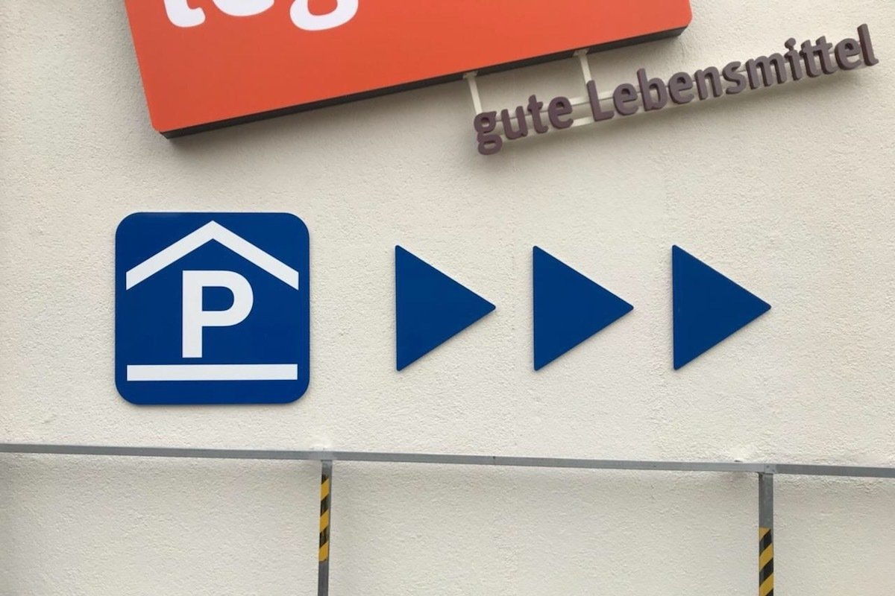
- 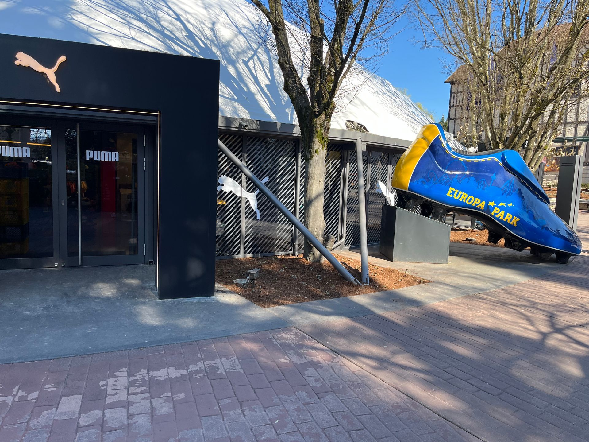
- 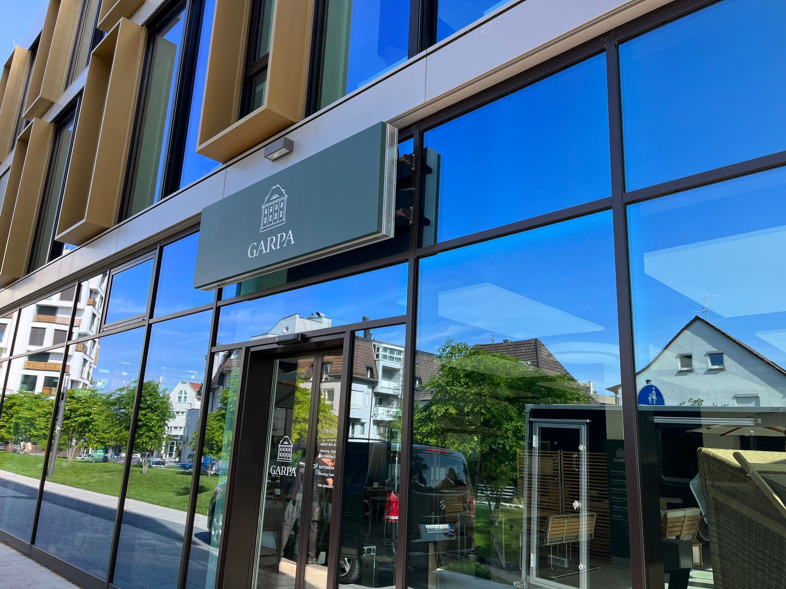
- 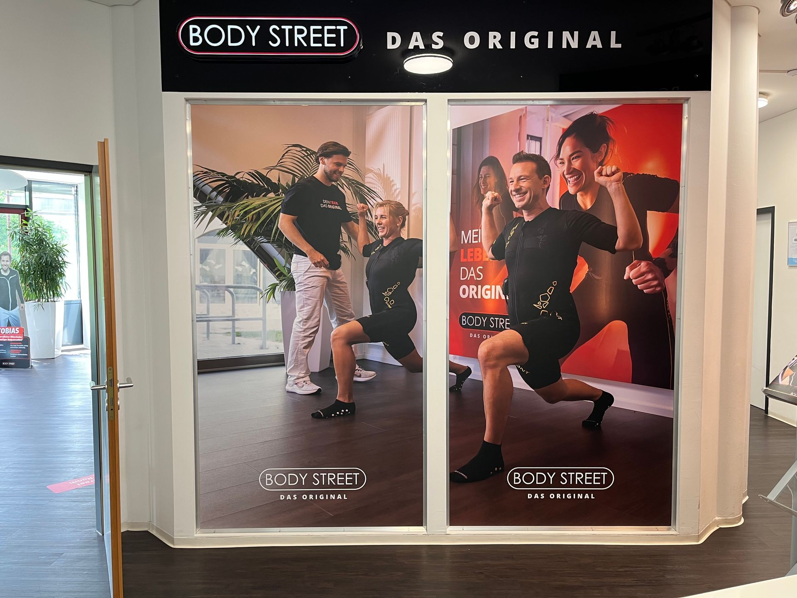
- 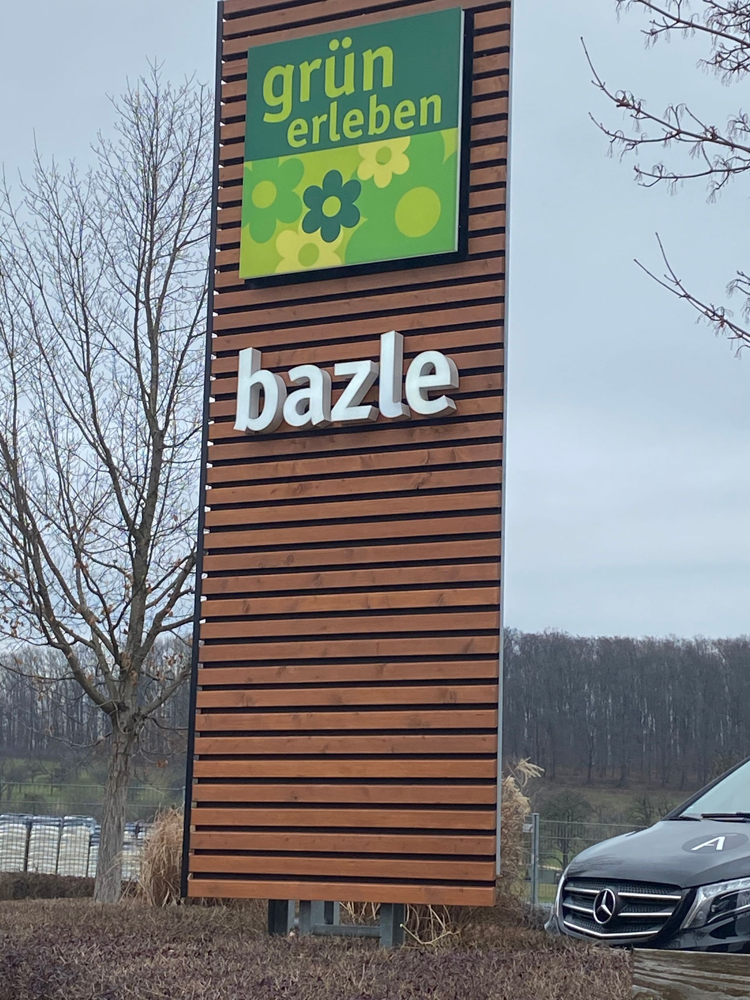
- 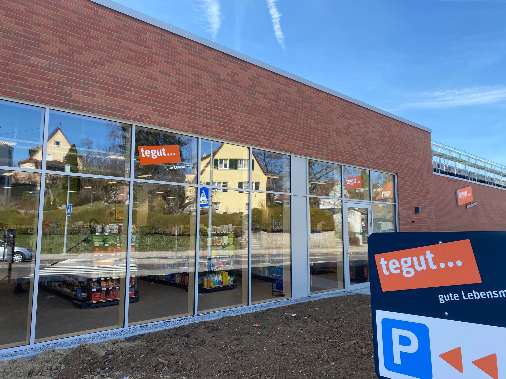
- 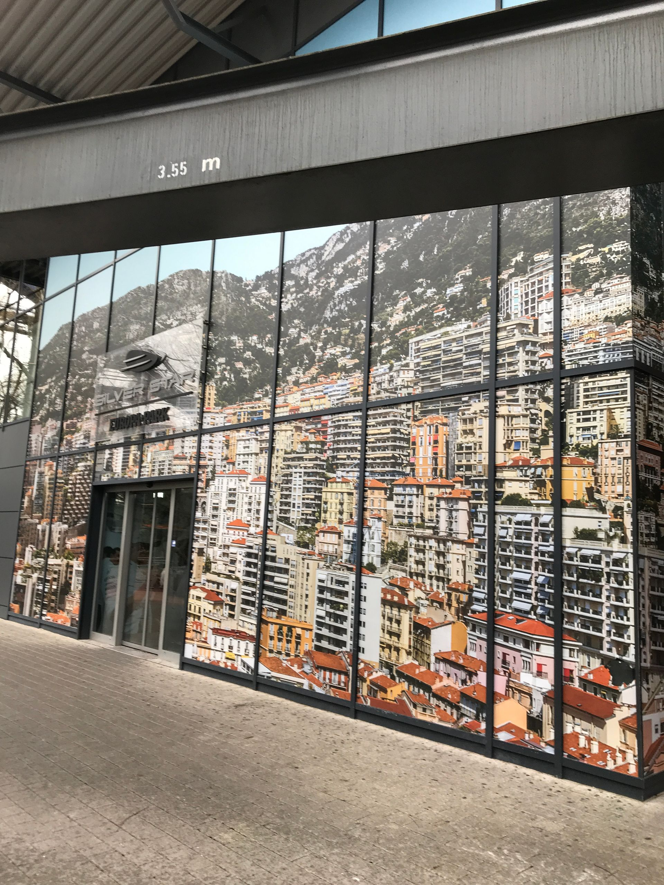
- 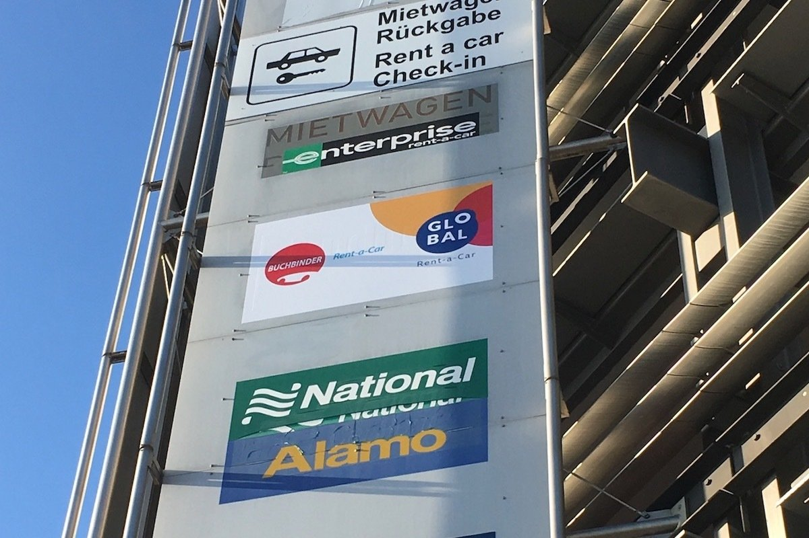
- 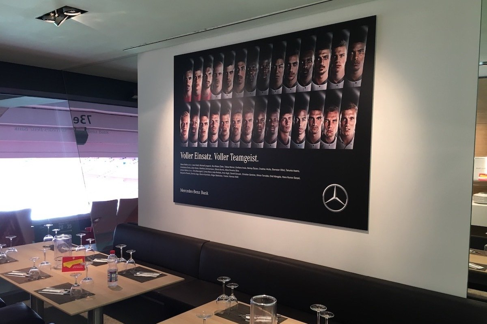
- 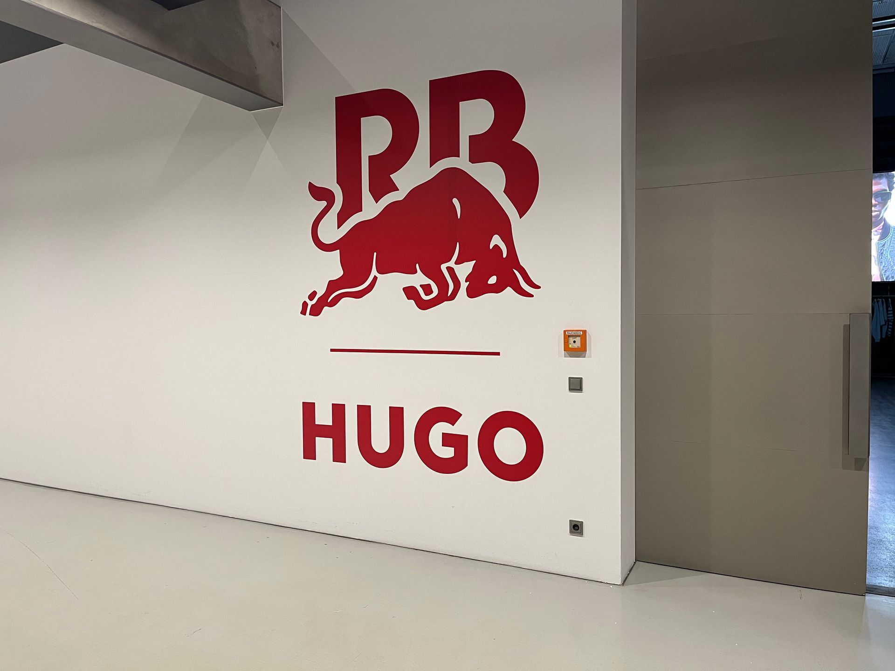
- 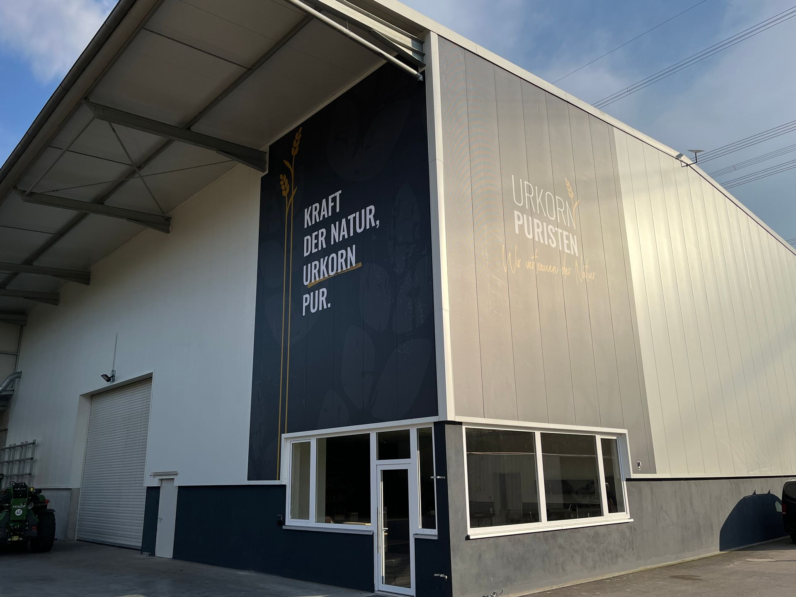
- 
