<!-- Originaltext wörtlich übernommen (inkl. Tippfehler). Screenshot: _raw/screenshots/gebaeude-objekt.png -->

... 
Der Anspruch an ein Leit- und/oder Orientierungssystem ist oft hoch. In enger Abstimmung mit Architekten und Bauherren entwickeln und montieren wir Leit- und/oder Orientierungssysteme, deren Design und Typografie mit dem Gebäudedesign abgestimmt sind. Weiter erarbeiten wir in Abstimmung auch Flucht- und Rettungspläne und führen die Kennzeichnung im Objekt aus.

## Bilder (Reihenfolge alphabetisch, nicht wie im Original-Layout)

- 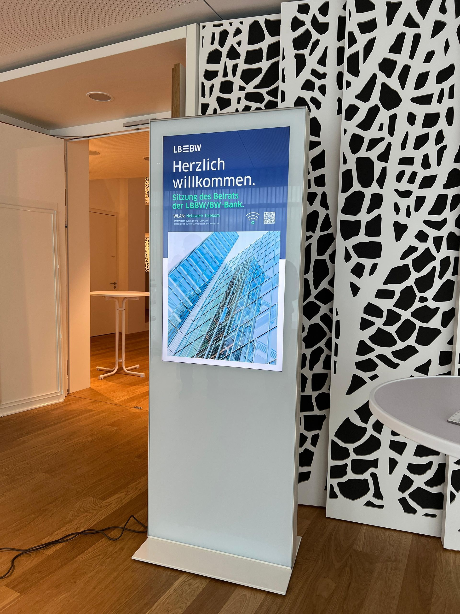
- 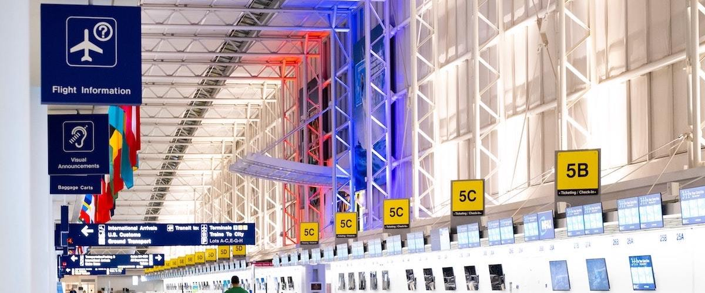
- 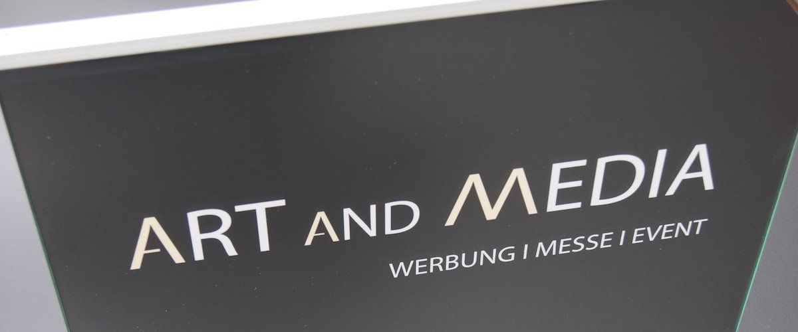
- 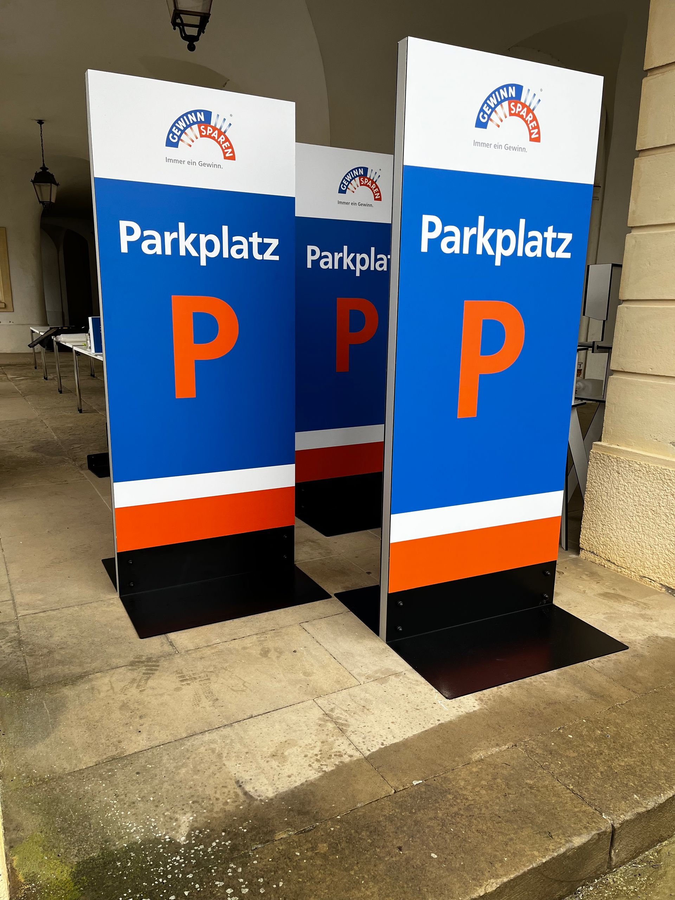
- 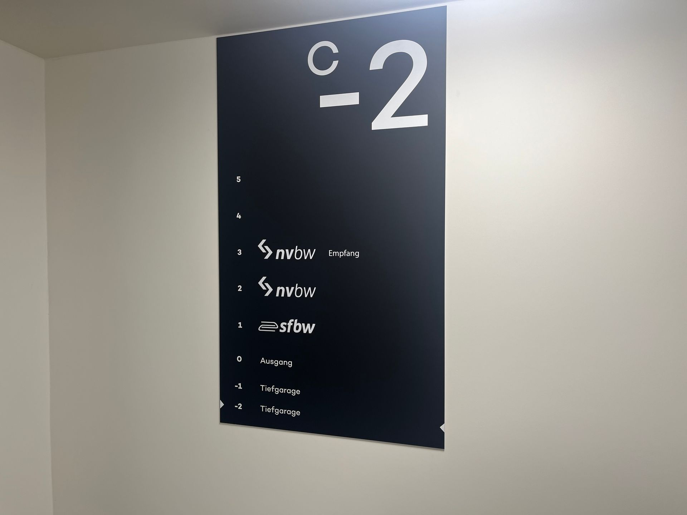
- 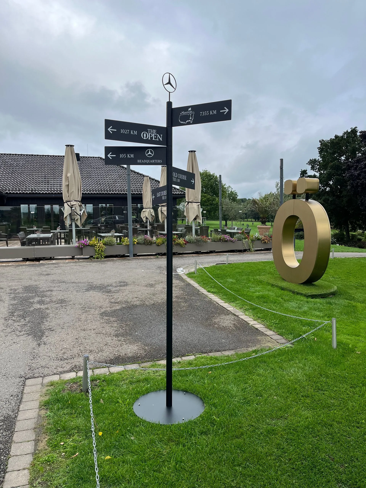
- 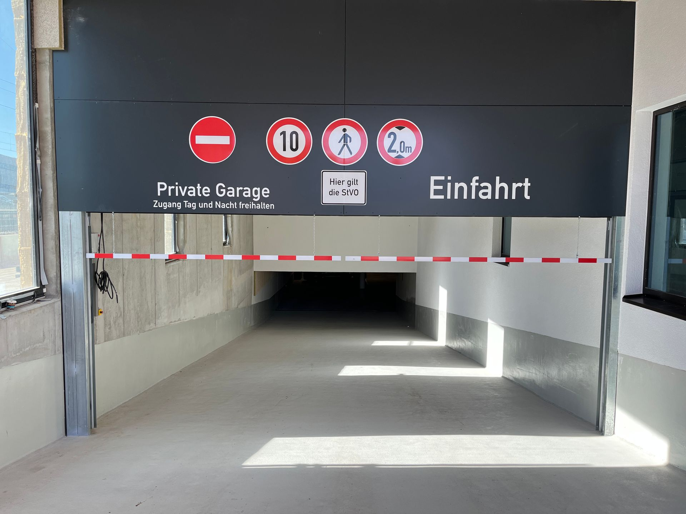
- 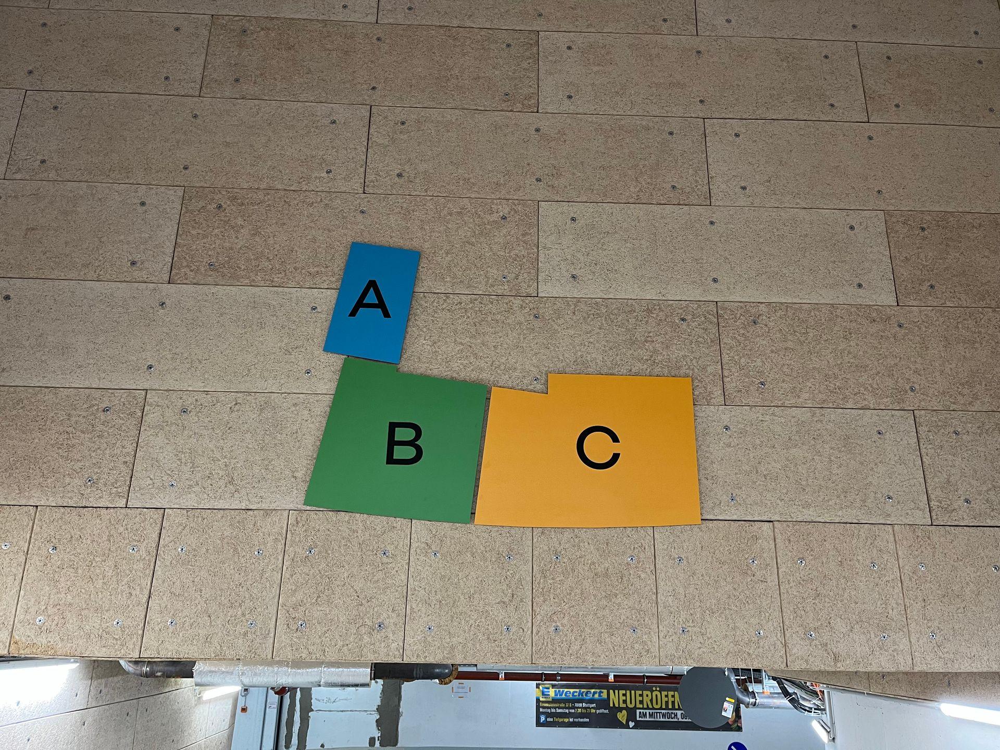
- 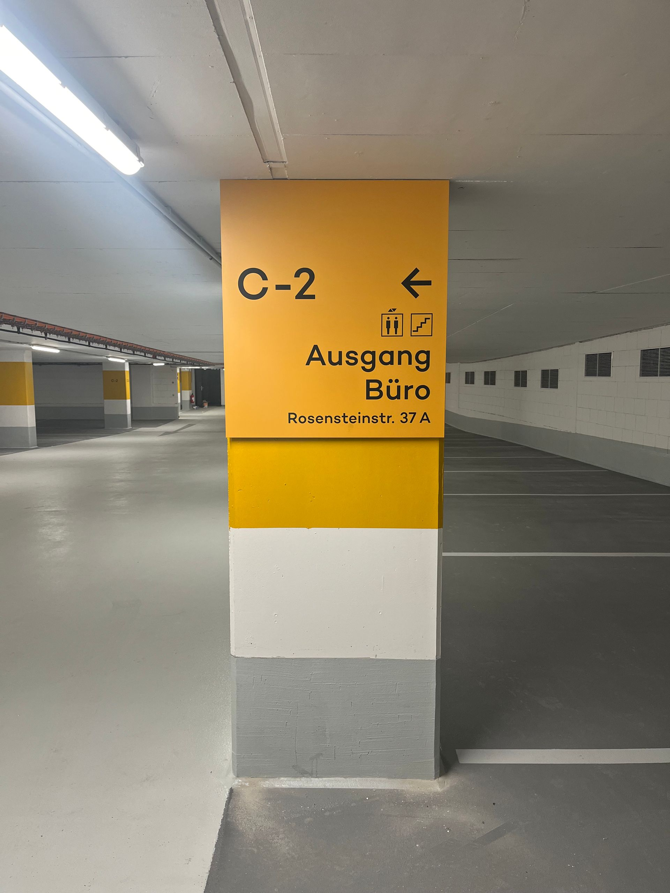
- 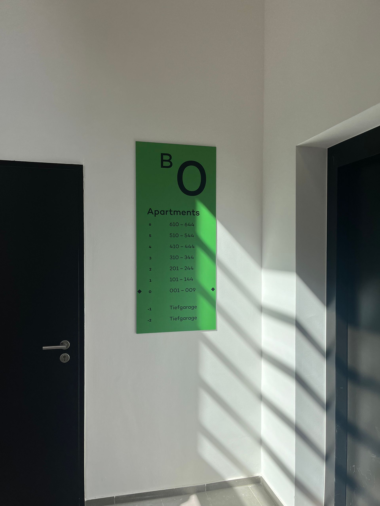
- 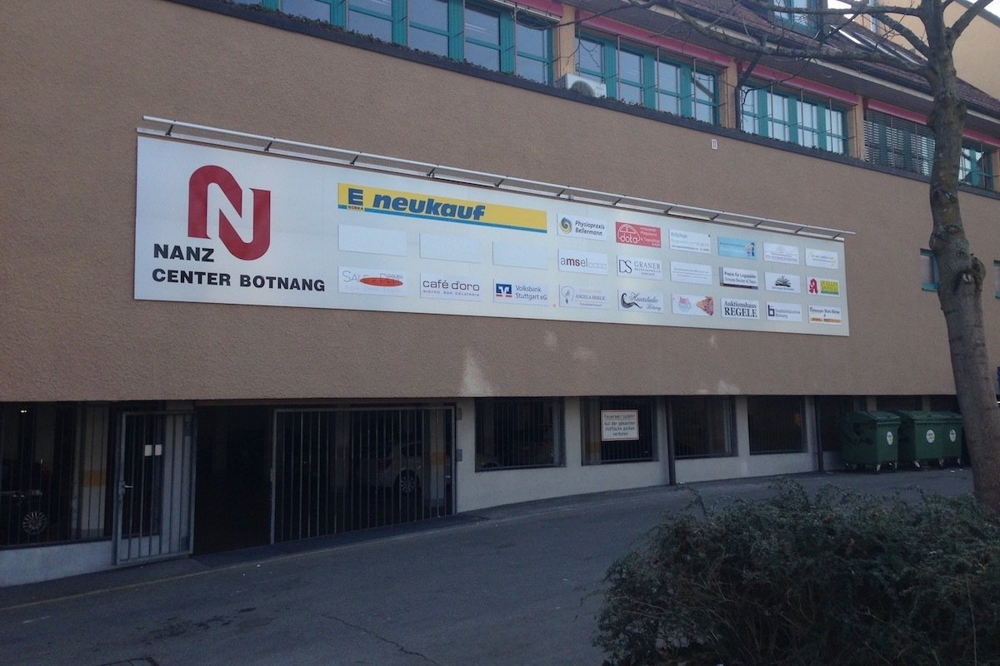
